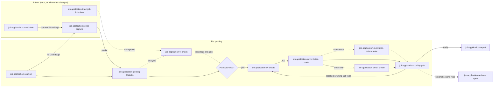

# Skills und Agenten

| Name | Phase | Zweck |
|---|---|---|
| `job-application-solution` | plan | Einstieg: Profil, Analyse, Freigabe des Plans, Unterlagen, Qualitätsprüfung |
| `job-application-profile-capture` | intake | Erstellt die Datengrundlage und leitet daraus `job-application/profil.md` ab |
| `job-application-posting-analysis` | analyse | Extrahiert die Anforderungen und gleicht sie belegt mit der Datengrundlage ab; ordnet den Ansprechpartner ein und erfasst die Firmenrollen |
| `job-application-cv-create` | create | Einspaltiger deutscher Lebenslauf im Format der Situation |
| `job-application-cv-maintain` | intake | Geführtes Pflegeinterview für eine bestehende Datengrundlage: prüft Kernpunkte, fragt nach Befunden |
| `job-application-traumjob-interview` | intake | Siebenphasiges Interview, das das bestätigte Wunschprofil speichert |
| `job-application-fit-check` | analyse | Prüft eine Stelle oder ein Unternehmen gegen das Wunschprofil; Vetos zuerst, jeder Wert belegt |
| `job-application-cover-letter-create` | create | Einseitiges Anschreiben im DIN-Format, vier Varianten |
| `job-application-motivation-letter-create` | create | Motivationsschreiben aus den vom Nutzer genannten Beweggründen und belegten Nachweisen, mit Herkunftsnachweis |
| `job-application-email-create` | deliver | Begleit-E-Mail mit Betreff, Anhangsliste und Dateinamen |
| `job-application-export` | deliver | Exportiert ein fertiges Dokument als DOCX, HTML oder Markdown; PDF über LaTeX (braucht LuaLaTeX) via `task export` |
| `job-application-quality-gate` | review | Qualitätsprüfung: Blocker, Warnungen, Hinweise |
| `job-application-reviewer` (Agent) | review | Schreibgeschützte Gesamtprüfung aus Sicht einer Personalerin |

**Aufrufreihenfolge**

Die Skills laufen für jede Stellenanzeige in fester Reihenfolge. Die einmaligen Schritte, also Interview und Datengrundlage, kommen vorher. `job-application-solution` steuert den Lauf und wartet auf deine Freigabe, bevor ein Dokument entsteht. Das Diagramm zeigt, welcher Skill welche Datei an den nächsten übergibt. Gestrichelte Pfeile sind optional.

<!-- diagram-source: user-described—order of the job-application skills per posting, from intake to quality gate and export -->

