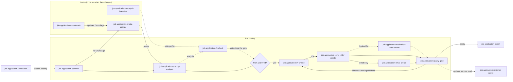

# Skills and agents

The *Stage* column names the step of the application process (S0 to S10, see
[Getting started](getting-started.md#7-status-and-overview)) in which the skill runs.

| Name | Stage | Purpose |
|---|---|---|
| `job-application-job-search` | search (before S1) | Optional: builds a Suchbrief from your Wunschprofil, shows it, and after your yes searches job boards through the optional [JobSpy](jobspy.md) server. Returns a shortlist, records it in `suche/`, and hands one chosen posting to `job-application-solution` |
| `job-application-solution` | front door (S1–S5) | Front door: profile, analysis, plan approval, documents, quality gate. Writes the approved plan to `vorgang.md` |
| `job-application-profile-capture` | intake (S0) | Builds the Datengrundlage from your raw documents and derives `profil.md` from it |
| `job-application-cv-maintain` | intake (S0) | Guided maintenance interview for an existing Datengrundlage: checks core points, asks about findings |
| `job-application-traumjob-interview` | intake (S0) | Seven-phase preference interview that stores the confirmed Wunschprofil |
| `job-application-fit-check` | analysis (S2) | Checks a posting or company against the Wunschprofil; vetoes first, every value sourced |
| `job-application-posting-analysis` | intake and analysis (S1–S2) | Takes a posting URL alone: cleans tracking parameters, loads the page through the open-webSearch server, shows the extracted fields and the posting text for your confirmation, then saves it (see [Browser MCP](browser.md)). Creates the Vorgang (`stellenanzeige.md`, `vorgang.md`, `notizen.md`, company file in `firmen/`), extracts requirements and matches them to the Datengrundlage with evidence; classifies the counterpart and records the company roles; always runs research level 0 on the posting, levels 1 and 2 on request (`## Recherche`), LinkedIn only through the MCP server with your consent; the commercial register through the Handelsregister server with your consent (see [Handelsregister access](handelsregister.md)); web search and page fetches preferably through the open-webSearch server when connected, otherwise the built-in tools (see [Web search](websearch.md)) |
| `job-application-cv-create` | creation (S4) | Single-column German CV in the format chosen for the situation |
| `job-application-cover-letter-create` | creation (S4) | One-page DIN-style cover letter, four variants |
| `job-application-motivation-letter-create` | creation (S4) | Motivationsschreiben from your stated reasons and sourced proofs, with a provenance note |
| `job-application-email-create` | creation (S4) | Cover e-mail with subject, attachment list and file names, only when you apply by e-mail |
| `job-application-quality-gate` | review (S5) | Quality gate: blockers, warnings, notes. Sets the status to `geprüft` (no blockers) or `in Arbeit` |
| `job-application-export` | export (S6) | Exports a finished document to DOCX, HTML or Markdown; PDF through LaTeX (needs LuaLaTeX or the container) via `task export` |
| `job-application-reviewer` (agent) | review (S5) | Read-only whole-set review from a recruiter's perspective |

## What the skills record

Every skill that works on an application writes into that application's folder and nothing
else. The status in `vorgang.md` tells you how far an application has come:

| Step | Who writes | Files | Status afterwards |
|---|---|---|---|
| Postings searched | `job-application-job-search` | `suche/<JJJJ-MM-TT>-<slug>.md` (not a Vorgang: no `vorgang.md`) | none |
| Posting captured | `job-application-posting-analysis` | `stellenanzeige.md`, `vorgang.md`, `notizen.md` (empty), `firmen/<company>.md` on first contact | `erfasst` |
| Analysed | `job-application-posting-analysis` | `analyse.md` | `analysiert` |
| Plan approved | `job-application-solution` | section *Plan* in `vorgang.md` | `geplant` |
| Documents created | `job-application-cv-create`, `-cover-letter-create`, `-motivation-letter-create`, `-email-create` | `lebenslauf.md`, `anschreiben.md`, `motivationsschreiben.md`, `email.md`, `pruefbericht.md` (section *Auswahl*) | `erstellt` |
| Checked | `job-application-quality-gate` | `pruefbericht.md` (section *Prüfung*) | `geprüft` or `in Arbeit` |
| Exported | `job-application-export` | `export/` | unchanged |

## What you maintain yourself

Sending and everything after it are your statements, not the plugin's. You record them in
`vorgang.md` (date sent, channel, attachments, each reply, each interview, the final result)
and keep your free notes in `notizen.md`. Obsidian is a comfortable place for this; the
plugin does not need it. [Getting started](getting-started.md#7-status-and-overview) shows the
status values and an overview across all applications.

## Call order

The skills run in a fixed order for each posting. The one-time steps, the preference interview
and the Datengrundlage, come first. `job-application-solution` drives the run and waits for
your approval before any document is created. The diagram shows which skill hands which file
to the next one. Dashed arrows are optional.

<!-- diagram-source: user-described—order of the job-application skills per posting, from intake to quality gate and export -->

