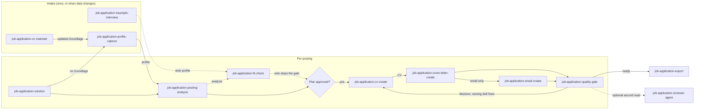

# Skills and agents

| Name | Phase | Purpose |
|---|---|---|
| `job-application-solution` | plan | Front door: profile, analysis, plan approval, documents, quality gate |
| `job-application-profile-capture` | intake | Builds the Datengrundlage and derives `job-application/profil.md` from it |
| `job-application-posting-analysis` | analyse | Extracts requirements and matches them to the profile with evidence |
| `job-application-cv-create` | create | Single-column German CV in the format chosen for the situation |
| `job-application-cv-maintain` | intake | Guided maintenance interview for an existing Datengrundlage: checks core points, asks about findings |
| `job-application-traumjob-interview` | intake | Seven-phase preference interview that stores the confirmed Wunschprofil |
| `job-application-fit-check` | analyse | Checks a posting or company against the Wunschprofil; vetoes first, every value sourced |
| `job-application-cover-letter-create` | create | One-page DIN-style cover letter, four variants |
| `job-application-email-create` | deliver | Cover e-mail, subject, attachment list and file names |
| `job-application-export` | deliver | Exports a finished document to PDF (LaTeX), DOCX, HTML or Markdown via `task export` |
| `job-application-quality-gate` | review | Quality gate: blockers, warnings, notes |
| `job-application-reviewer` (agent) | review | Read-only whole-set review from a recruiter's perspective |

**Call order**

The skills run in a fixed order for each posting. The one-time steps, the preference interview and the Datengrundlage, come first. `job-application-solution` drives the run and waits for your approval before any document is created. The diagram shows which skill hands which file to the next one. Dashed arrows are optional.

<!-- diagram-source: user-described—order of the job-application skills per posting, from intake to quality gate and export -->

